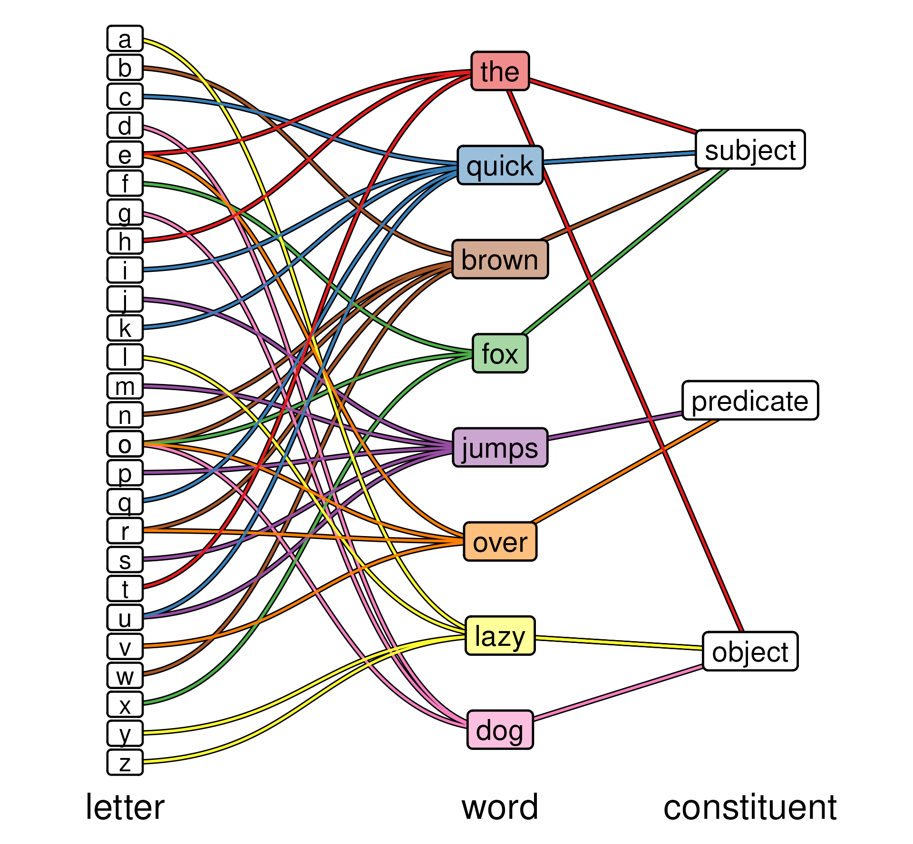
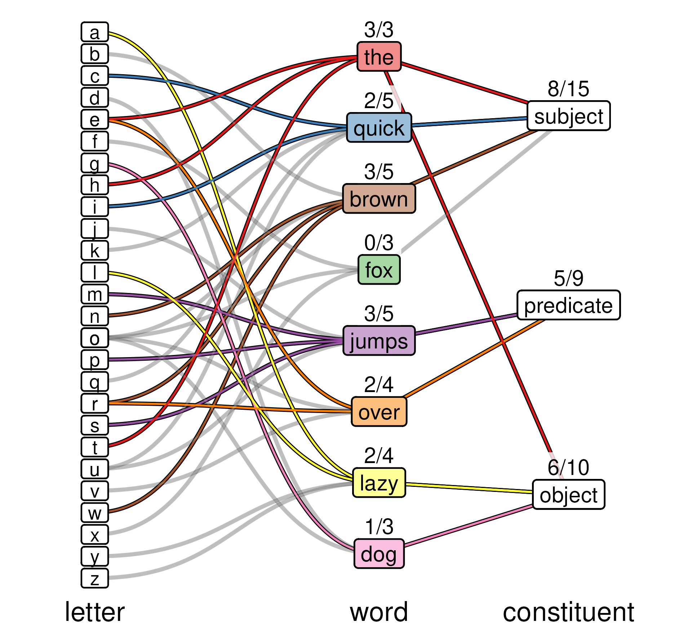
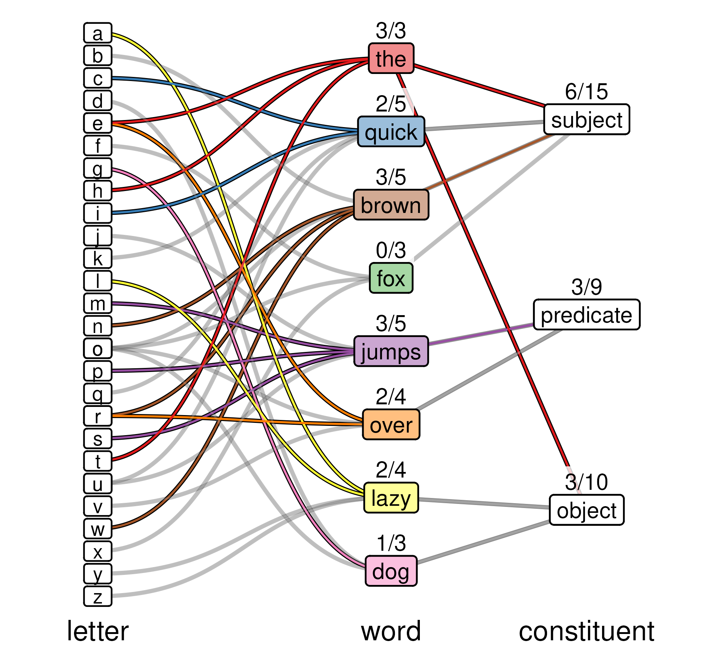

# Coverage and enrichment testing

## Overview

Among other things, the multifactor package provides a set of tools to
calculate coverage and estimate enrichment for relational datasets. This
type of operation forms the basis for bioinformatics techniques such as
pathway enrichment analysis (PEA), but have application far beyond the
biological sciences.

### Setup

\
[`library`](https://rdrr.io/r/base/library.html)`(`[`multifactor`](https://minotau-r.github.io/multifactor/)`)`\
\
`# Wrangling`\
[`library`](https://rdrr.io/r/base/library.html)`(`[`dplyr`](https://dplyr.tidyverse.org)`)`\
[`library`](https://rdrr.io/r/base/library.html)`(`[`tidyr`](https://tidyr.tidyverse.org)`)`\
[`library`](https://rdrr.io/r/base/library.html)`(`[`stringr`](https://stringr.tidyverse.org)`)`\
\
`# Plotting`\
[`library`](https://rdrr.io/r/base/library.html)`(`[`ggplot2`](https://ggplot2.tidyverse.org)`)`\
[`library`](https://rdrr.io/r/base/library.html)`(`[`patchwork`](https://patchwork.data-imaginist.com)`)`\
[`library`](https://rdrr.io/r/base/library.html)`(`[`ggforce`](https://ggforce.data-imaginist.com)`)`\
[`library`](https://rdrr.io/r/base/library.html)`(`[`systemfonts`](https://github.com/r-lib/systemfonts)`)`\
[`library`](https://rdrr.io/r/base/library.html)`(`[`ragg`](https://ragg.r-lib.org)`)`\
\
`# Define utility function`\
`split_to_letters`` ``<-`` ``function``(``x``)`` `[`unique`](https://rdrr.io/r/base/unique.html)`(`\
`  `[`unlist`](https://rdrr.io/r/base/unlist.html)`(`\
`    `[`strsplit`](https://rdrr.io/r/base/strsplit.html)`(`[`gsub`](https://rdrr.io/r/base/grep.html)`(``" "``, ``""``, ``x``)``, split ``=`` ``""``)``,`\
`    recursive ``=`` ``TRUE``, use.names ``=`` ``FALSE`\
`  ``)`\
`)`

#### Example Dataset: The Quick Brown Fox

We will use a toy data set of hierarchically structured data, namely the
sentence: ‘The quick brown fox jumps over the lazy dog.’ This sentence
is a pangram, meaning that all 26 letters of the English alphabet are
represented. Moreover, we have deconstructed the sentence to three
levels; letters, words and constituents.

\
`# Load the quick brown fox data set`\
[`set.seed`](https://rdrr.io/r/base/Random.html)`(``2612``)`\
`fox`` ``<-`` `[`quickbrownfox`](https://minotau-r.github.io/multifactor/reference/quickbrownfox.md)`(``)`

We could represent these relations visually like so:

We can convince ourselves this same information is captured in the
multifactor object, `fox`.

\
[`levels`](https://rdrr.io/r/base/levels.html)`(``fox``)`\
`#> $letter`\
`#>  [1] "a" "b" "c" "d" "e" "f" "g" "h" "i" "j" "k" "l" "m" "n" "o" "p" "q" "r" "s"`\
`#> [20] "t" "u" "v" "w" "x" "y" "z"`\
`#> `\
`#> $word`\
`#> [1] "brown" "dog"   "fox"   "jumps" "lazy"  "over"  "quick" "the"  `\
`#> `\
`#> $constituent`\
`#> [1] "object"    "predicate" "subject"  `\
`#> `\
`#> $sentence`\
`#> [1] "the quick brown fox jumps over the lazy dog"`\
\
[`as.matrix`](https://rdrr.io/r/base/matrix.html)`(``fox``$``letter2word``)`\
`#> 26 x 8 sparse Matrix of class "ngCMatrix"`\
`#>       word`\
`#> letter brown dog fox jumps lazy over quick the`\
`#>      a     .   .   .     .    |    .     .   .`\
`#>      b     |   .   .     .    .    .     .   .`\
`#>      c     .   .   .     .    .    .     |   .`\
`#>      d     .   |   .     .    .    .     .   .`\
`#>      e     .   .   .     .    .    |     .   |`\
`#>      f     .   .   |     .    .    .     .   .`\
`#>      g     .   |   .     .    .    .     .   .`\
`#>      h     .   .   .     .    .    .     .   |`\
`#>      i     .   .   .     .    .    .     |   .`\
`#>      j     .   .   .     |    .    .     .   .`\
`#>      k     .   .   .     .    .    .     |   .`\
`#>      l     .   .   .     .    |    .     .   .`\
`#>      m     .   .   .     |    .    .     .   .`\
`#>      n     |   .   .     .    .    .     .   .`\
`#>      o     |   |   |     .    .    |     .   .`\
`#>      p     .   .   .     |    .    .     .   .`\
`#>      q     .   .   .     .    .    .     |   .`\
`#>      r     |   .   .     .    .    |     .   .`\
`#>      s     .   .   .     |    .    .     .   .`\
`#>      t     .   .   .     .    .    .     .   |`\
`#>      u     .   .   .     |    .    .     |   .`\
`#>      v     .   .   .     .    .    |     .   .`\
`#>      w     |   .   .     .    .    .     .   .`\
`#>      x     .   .   |     .    .    .     .   .`\
`#>      y     .   .   .     .    |    .     .   .`\
`#>      z     .   .   .     .    |    .     .   .`

## Calculate coverage

### Introduction

With coverage, we mean the proportion of items in a set that are
present. In other words, going back to our example, given some number of
letters, we can calculate which words we can make, and how complete they
are.

To demonstrate, let’s first consider the graph representation of our
dataset: 

Three feature types are shown on the x-axis, with links between
respective levels as lines. We can see that each letter is linked to the
words it appears in, which are in turn linked to their corresponding
constituents.

We’ll also need to generate some collection of letters as input data:

\
`# Generate some collection of letters`\
`input`` ``<-`` ``split_to_letters``(``"a pangram is a sentence with all letters"``)`\
\
`input`\
`#>  [1] "a" "p" "n" "g" "r" "m" "i" "s" "e" "t" "c" "w" "h" "l"`

### Defining coverage in a path

### weave_coverage()

We can use the
[`weave_coverage()`](https://minotau-r.github.io/multifactor/reference/weave_coverage-generic.md)
function to calculate to what degree the input letters cover the words
in our data set. This function behaves similarly to
[`weave()`](https://minotau-r.github.io/multifactor/reference/weave-generic.md),
in the sense that it takes a multifactor as its first argument, `x`, and
its second argument, `.path`, defines the path through that multifactor.
It also has an additional argument, `.data`.

For now, let’s plug in our input letters:

\
`res`` ``<-`` `[`weave_coverage`](https://minotau-r.github.io/multifactor/reference/weave_coverage-generic.md)`(`\
`  x ``=`` ``fox``, .path ``=`` ``letter`` ``~`` ``word`` ``~`` ``constituent``, .data ``=`` ``input`\
`)`

#### Filter using `subset()`

We can use the [`subset()`](https://rdrr.io/r/base/subset.html) method
for `linkmap` to automatically filter for complete cases, only the word
‘the’ is complete:

\
[`subset`](https://rdrr.io/r/base/subset.html)`(``res``)`\
`#> A multifactor::linkmap data.frame S7_object: 0 rows.`\
`#> [1] letter      constituent`\
`#> <0 rows> (or 0-length row.names)`\
`#> `\
`#> @ levels:   2 variables: `\
`#>  $ letter      : 26 Levels: a ... z `\
`#>  $ constituent :  3 Levels: object predicate subject`

By default, coverage is only calculated between the data types involved
in the last step of the path. However, we can specify conditional
filtering steps.

#### Complete coverage

When defining a path, we can use the `:` operator as shorthand for
complete coverage (`>= 1`). For example:
`letter ~ word ~ constituent >= 1` is equivalent to
`letter ~ word : constituent`.

\
[`weave_coverage`](https://minotau-r.github.io/multifactor/reference/weave_coverage-generic.md)`(`\
`  x ``=`` ``fox``, .path ``=`` ``letter`` ``~`` ``word`` ``:`` ``constituent``, .data ``=`` ``input`\
`)`\
`#> A multifactor::linkmap data.frame S7_object: 0 rows.`\
`#> [1] letter      constituent`\
`#> <0 rows> (or 0-length row.names)`\
`#> `\
`#> @ levels:   2 variables: `\
`#>  $ letter      : 26 Levels: a ... z `\
`#>  $ constituent :  3 Levels: object predicate subject`

#### Partial coverage

We can similarly define threshold-based filters using relational
expressions. For example: `letter ~ word > 0.5 ~ constituent` is
equivalent to `letter ~ word : constituent`.

\
[`weave_coverage`](https://minotau-r.github.io/multifactor/reference/weave_coverage-generic.md)`(`\
`  x ``=`` ``fox``, .path ``=`` ``letter`` ``~`` ``word`` ``>`` ``0.5`` ``~`` ``constituent``, .data ``=`` ``input`\
`)`\
`#> A multifactor::linkmap data.frame S7_object: 34 rows.`\
`#>    letter constituent`\
`#> 1       a      object`\
`#> 2       d      object`\
`#> 3       e      object`\
`#> 4       g      object`\
`#> 5       h      object`\
`#> 6       l      object`\
`#> 7       o      object`\
`#> 8       t      object`\
`#> 9       y      object`\
`#> 10      z      object`\
`` #>  + 24 more rows. Use `print(n = ...)` to see more rows. ``\
`#> `\
`#> @ levels:   2 variables: `\
`#>  $ letter      : 26 Levels: a ... z `\
`#>  $ constituent :  3 Levels: object predicate subject `\
`#> `\
`#> @ metadata: 5 variables: `\
`#> List of 5`\
`#>  $ set_size : int  10 10 10 10 10 10 10 10 10 10 ...`\
`#>  $ observed : logi  FALSE FALSE TRUE FALSE TRUE FALSE ...`\
`#>  $ set_count: int  3 3 3 3 3 3 3 3 3 3 ...`\
`#>  $ coverage : num  0.3 0.3 0.3 0.3 0.3 0.3 0.3 0.3 0.3 0.3 ...`\
`#>  $ complete : logi  FALSE FALSE FALSE FALSE FALSE FALSE ...`

### Enrichment testing

The
[`test_enrich()`](https://minotau-r.github.io/multifactor/reference/test_enrich-generic.md)
allows for quick hypothesis testing using the same syntax:

\
[`test_enrich`](https://minotau-r.github.io/multifactor/reference/test_enrich-generic.md)`(``x ``=`` ``fox``, .path ``=`` ``letter`` ``~`` ``word``, .data ``=`` ``input``)`\
`#>        expected  observed      fold   log_fold   p.value p.adj`\
`#> brown 0.5384615 0.6000000 1.1142857  0.1561192 0.5782609     1`\
`#> dog   0.5384615 0.3333333 0.6190476 -0.6918777 0.9153846     1`\
`#> fox   0.5384615 0.0000000 0.0000000       -Inf 1.0000000     1`\
`#> jumps 0.5384615 0.6000000 1.1142857  0.1561192 0.5782609     1`\
`#> lazy  0.5384615 0.5000000 0.9285714 -0.1069152 0.7608696     1`\
`#> over  0.5384615 0.5000000 0.9285714 -0.1069152 0.7608696     1`\
`#> quick 0.5384615 0.4000000 0.7428571 -0.4288433 0.8826087     1`\
`#> the   0.5384615 1.0000000 1.8571429  0.8930848 0.1400000     1`

Alternatively,
[`test_enrich()`](https://minotau-r.github.io/multifactor/reference/test_enrich-generic.md)
can also be run on the result of an earlier
[`weave_coverage()`](https://minotau-r.github.io/multifactor/reference/weave_coverage-generic.md)
call for the same results:

\
[`test_enrich`](https://minotau-r.github.io/multifactor/reference/test_enrich-generic.md)`(``res``)`\
`#>            expected  observed      fold    log_fold   p.value     p.adj`\
`#> object    0.5384615 0.6000000 1.1142857  0.15611920 0.4640194 0.6759052`\
`#> predicate 0.5384615 0.5555556 1.0317460  0.04508789 0.6132723 0.6759052`\
`#> subject   0.5384615 0.5333333 0.9904762 -0.01380580 0.6759052 0.6759052`
